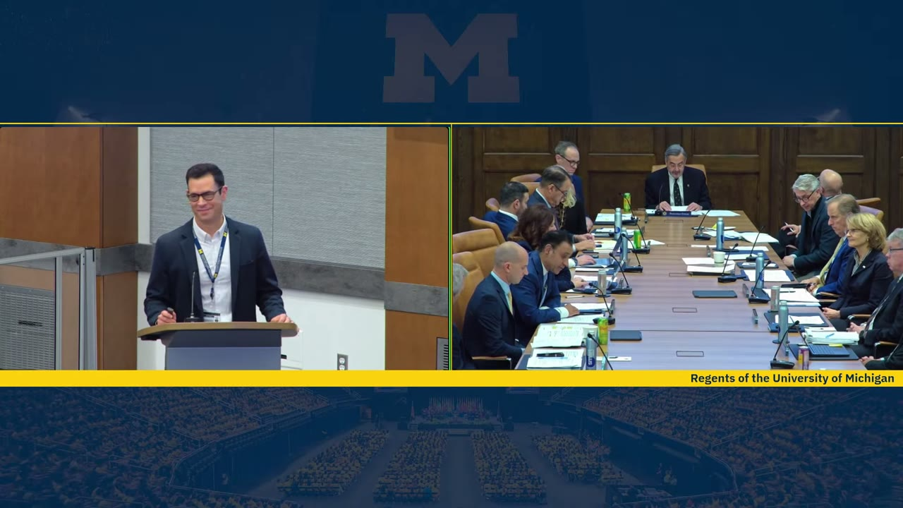

<!-- ## Bio {#bio} -->

I am a research scientist, neurosurgeon, and the Novello & Quinones-Hinojosa Research Professor of Neurosurgery at the University of Michigan. My outstanding team makes up the ***Machine Learning in Neurosurgery (MLiNS) Lab***, where we focus on developing machine intelligence that understands human health and disease, especially related to the nervous system. We aim to discover better data sources, model architectures, inductive biases, and learning enviroments for medical AI. Our technical contributions include improved visual self-supervision, hierarchical and multimodal representation learning, and medical foundation modeling.

We are actively *hiring phd students and postdocs in medical AI*. Projects can cover any of the research programs below. Please email me directly at tocho [at] umich.edu if interested.

**Patients seeking care:** please see [For Patients](/patients/) for how to request an appointment.

## [Photos and Bios of MLiNS Team](/students/) {#team}

The team, the team, the team.

## [MLiNS Research Programs](/research/) {#research}

-  **[AI-based Neuroimaging](/research/neuroimaging/)** - AI for brain and spine imaging
-  **[Intelligent Histology](/research/intelligent-histology/)** - intraoperative microscopy, label-free imaging
-  **[Visual Intelligence](/research/computer-vision/)** - visual reasoning, self-supevised learning, vision-language modeling
-  **[Patient Forecasting](/research/patient-forecasting/)** - patient outcome and survival prediction
-  **[Collaborative Neuro-Oncology](/research/collaborative-neuro-oncology/)** - team science in brain tumor research
{: .program-list}

## [MLiNS Demos](https://apps.mlins.org/){:target="_blank" rel="noopener"} {#demos}

Try our models in your browser - interactive demos for <strong>Prima</strong>, <strong>FastGlioma</strong>, and <strong>DeepGlioma</strong>.

## MLiNS News {#news}

- **Nov 2026** - Todd Hollon invited to present to University of Michigan Board of Regents. Watch the [Video](#videos) (starts at 1:01:28) and read [The Michigan Daily](https://www.michigandaily.com/news/administration/umich-board-of-regents-votes-to-proceed-with-1-2-billion-data-center/){:target="_blank" rel="noopener"} coverage.
- **Nov 2026** - Chenhui Zhao's and Akshay Rao's preprint, [Neuro-VL: A frontier machine intelligence for human neuroimaging](https://arxiv.org/abs/2611.15094), is released on ***arXiv***. Watch the [video](#selected-preprints) and try the [Demo](https://neurovl.mlins.org/).
- **Sep 2026** - [Optical microscopy predictions of focal recurrence in glioblastoma](https://www.science.org/doi/10.1126/sciadv.aec8202), a collaboration with the Hervey-Jumper Lab at UCSF using **FastGlioma** to forecast where glioblastoma will recur, is published in ***Science Advances***.
- **Sep 2026** - The MLiNS Lab added two talented students, **Annie Huang** and **Prateek Pinchi**.
- **Aug 2026** - Akhil Kondepudi's Research Briefing, [Learning from routine health system data builds better neuroimaging AI models](https://www.nature.com/articles/s41591-026-04567-4), is published in ***Nature Medicine***.
- **Jul 2026** - Todd Hollon's editorial, [Benchmarking the Brain's Blood Vessels](https://ai.nejm.org/doi/full/10.1056/AIe2600897), is published in ***NEJM AI***.
- **Jul 2026** - Akhil Kondepudi's [NeuroVFM](https://www.nature.com/articles/s41591-026-04497-1) is published in ***Nature Medicine***. Check out the [Demo](https://neurovfm.mlins.org/).
- **May 2026** - [FastGlioma](https://www.nature.com/articles/s41586-024-08169-3), published in ***Nature***, is featured by UM [Look to Michigan](https://looktomichigan.umich.edu/stories/fastglioma/) campaign.
- **Apr 2026** - Xinhai Hou's paper, ***CodeV***, is accepted at ***CVPR*** as *Oral Paper (Top 1%)*.
- **Feb 2026** - [Prima](https://www.nature.com/articles/s41551-025-01608-0) is published in ***Nature Biomedical Engineering***.
- **Feb 2026** - Yiwei Lyu's paper, ***ItemizedCLIP***, is accepted at ***CVPR***.
- **Dec 2025** - MLiNS lab's featured in [The Detroit News](https://archive.ph/Efqzr) by UM president Domenico Grasso.
- More news [HERE](/news/).

<a href="#top">↑ Back to top</a>

## New Preprints {#selected-preprints}

<video controls playsinline preload="metadata" width="1896" height="904" aria-label="Neuro-VL demo video">
<source src="/assets/videos/neuro-vl.mp4#t=0.1" type="video/mp4">
</video>

[Neuro-VL](https://arxiv.org/abs/2611.15094){:target="_blank" rel="noopener"}: conversational interpretation of complete neuroimaging studies.

<iframe src="https://www.youtube-nocookie.com/embed/IonqTwTNwuI" title="A frontier machine intelligence for human neuroimaging | AI Papers Podcast Daily" loading="lazy" allow="accelerometer; clipboard-write; encrypted-media; gyroscope; picture-in-picture; web-share" referrerpolicy="strict-origin-when-cross-origin" allowfullscreen></iframe>

Listen: [Neuro-VL podcast](https://www.youtube.com/watch?v=IonqTwTNwuI){:target="_blank" rel="noopener"} (AI Papers Podcast Daily).



<a href="#top">↑ Back to top</a>

## Selected Publications and [Complete Publications List](/publications/)  {#selected-publications}



<a href="#top">↑ Back to top</a>

## MLiNS Videos and Podcasts {#videos}

[University of Michigan Regents Meeting - November 2026](https://www.youtube.com/watch?v=I7l98lXIxMI&t=3688s){:target="_blank" rel="noopener"} (starts at 1:01:28).

<iframe src="https://www.youtube-nocookie.com/embed/jvSRfXlVdLw" title="Pioneering the Future of Brain Surgery | Look to Michigan" allow="accelerometer; clipboard-write; encrypted-media; gyroscope; picture-in-picture; web-share" referrerpolicy="strict-origin-when-cross-origin" allowfullscreen></iframe>

[Pioneering the Future of Brain Surgery > Look to Michigan](https://looktomichigan.umich.edu/stories/fastglioma/){:target="_blank" rel="noopener"}



More videos and podcasts [here](/videos/).

<a href="#top">↑ Back to top</a>

## [Support for MLiNS Lab](/support/) {#support}

- [NIH NCI R01](https://reporter.nih.gov/search/fasIncKaf0K7CqBQs0Fyiw/project-details/11227784)
- [NIH NINDS K12](https://www.nrcdp.org/)
- [NIH NINDS F31](https://reporter.nih.gov/project-details/10824645)
- [Chan Zuckerberg Initiative](https://chanzuckerberg.com/science/programs-resources/imaging/community/?cycle=advancing-imaging-through-collaborative-projects)
- [Ian's Friends Foundation (Phil and Cheryl Yagoda)](https://iansfriendsfoundation.com/)
- [UM Frankel Institute for Heart and Brain Health](https://medresearch.umich.edu/labs-departments/centers/frankelihbh)
- [UM Scouts Program](https://medresearch.umich.edu/office-research/about-office-research/research-scouts/research-scouts-scholars-2023)
- [UM Department of Neurosurgery](https://medschool.umich.edu/departments/neurosurgery)
- [Scoliosis Research Society](https://www.srs.org/)
- [Cook Family Foundation](https://www.cookfamilyfoundation.org/)

Please email me directly at tocho [at] umich.edu if you would like to support our effort. **We are grateful for any contribution, big or small.**

<a href="#top">↑ Back to top</a>

